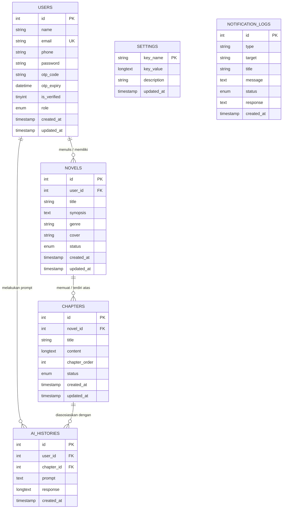

# SOFTWARE DESIGN DOCUMENT (SDD)
# SISTEM INFORMASI PLATFORM WEB NOVEL DAN AI WRITING ASSISTANT STUDIO (karyaNovel)

---

**Identifikasi Dokumen:** SDD-KN-2026-V1.0  
**Nama Perangkat Lunak:** karyaNovel  
**Mata Kuliah:** Rekayasa Perangkat Lunak (RPL)  
**Tahun Akademik:** 2026/2027  
**Status Dokumen:** Final Draft (Implementasi Aktual)  

---

## DAFTAR ISI

- [BAB I — PENDAHULUAN](#bab-i--pendahuluan)
  - [1.1 Latar Belakang](#11-latar-belakang)
  - [1.2 Tujuan Dokumen](#12-tujuan-dokumen)
  - [1.3 Ruang Lingkup Sistem](#13-ruang-lingkup-sistem)
  - [1.4 Gambaran Umum karyaNovel](#14-gambaran-umum-karyanovel)
- [BAB II — GAMBARAN ARSITEKTUR SISTEM](#bab-ii--gambaran-arsitektur-sistem)
  - [2.1 Arsitektur Aplikasi Berbasis MVC Native](#21-arsitektur-aplikasi-berbasis-mvc-native)
  - [2.2 Penjelasan Pola Model-View-Controller](#22-penjelasan-pola-model-view-controller)
  - [2.3 Alur Komunikasi Antar-Komponen Sistem](#23-alur-komunikasi-antar-komponen-sistem)
  - [2.4 Diagram Arsitektur Perangkat Lunak](#24-diagram-arsitektur-perangkat-lunak)
  - [2.5 Teknologi dan Pustaka yang Digunakan](#25-teknologi-dan-pustaka-yang-digunakan)
  - [2.6 Lingkungan Pengembangan dan Spesifikasi Server](#26-lingkungan-pengembangan-dan-spesifikasi-server)
- [BAB III — DESAIN PENGGUNA DAN HAK AKSES](#bab-iii--desain-pengguna-dan-hak-akses)
  - [3.1 Identifikasi Aktor Pengguna](#31-identifikasi-aktor-pengguna)
  - [3.2 Karakteristik dan Kewenangan Peran](#32-karakteristik-dan-kewenangan-peran)
  - [3.3 Matriks Perbandingan Hak Akses (RBAC Matrix)](#33-matriks-perbandingan-hak-akses-rbac-matrix)
- [BAB IV — DESAIN FUNGSIONAL SISTEM](#bab-iv--desain-fungsional-sistem)
  - [4.1 Alur Registrasi, Verifikasi OTP WhatsApp, dan Login](#41-alur-registrasi-verifikasi-otp-whatsapp-dan-login)
  - [4.2 Alur Manajemen Akun dan Profil Pengguna](#42-alur-manajemen-akun-dan-profil-pengguna)
  - [4.3 Alur Manajemen Naskah Novel](#43-alur-manajemen-naskah-novel)
  - [4.4 Alur Manajemen Bab dan Penomoran Bab](#44-alur-manajemen-bab-dan-penomoran-bab)
  - [4.5 Alur Ruang Kerja Editor dan Fitur Autosave](#45-alur-ruang-kerja-editor-dan-fitur-autosave)
  - [4.6 Alur Siklus Publikasi Naskah](#46-alur-siklus-publikasi-naskah)
  - [4.7 Alur Penjelajahan Katalog dan Pembacaan Novel Publik](#47-alur-penjelajahan-katalog-dan-pembacaan-novel-publik)
  - [4.8 Alur Pengawasan Dashboard dan Moderasi Admin](#48-alur-pengawasan-dashboard-dan-moderasi-admin)
  - [4.9 Alur Operasional AI Writing Assistant Studio](#49-alur-operasional-ai-writing-assistant-studio)
  - [4.10 Alur Layanan Percakapan Chatbot karyaNovel](#410-alur-layanan-percakapan-chatbot-karyanovel)
- [BAB V — DESAIN BASIS DATA (DATABASE DESIGN)](#bab-v--desain-basis-data-database-design)
  - [5.1 Mesin Basis Data yang Digunakan](#51-mesin-basis-data-yang-digunakan)
  - [5.2 Daftar Entitas dan Tabel](#52-daftar-entitas-dan-tabel)
  - [5.3 Struktur Kolom, Tipe Data, dan Constraint](#53-struktur-kolom-tipe-data-dan-constraint)
  - [5.4 Kunci Utama (Primary Key) dan Kunci Asing (Foreign Key)](#54-kunci-utama-primary-key-dan-kunci-asing-foreign-key)
  - [5.5 Relasi Antartabel dan Kardinalitas](#55-relasi-antartabel-dan-kardinalitas)
  - [5.6 Entity Relationship Diagram (ERD)](#56-entity-relationship-diagram-erd)
- [BAB VI — DESAIN ANTARMUKA PENGGUNA (UI/UX DESIGN)](#bab-vi--desain-antarmuka-pengguna-uiux-design)
  - [6.1 Pendekatan Desain dan Tema Visual](#61-pendekatan-desain-dan-tema-visual)
  - [6.2 Desain Halaman Beranda (Landing Page)](#62-desain-halaman-beranda-landing-page)
  - [6.3 Desain Halaman Autentikasi (Login, Register, Verify OTP)](#63-desain-halaman-autentikasi-login-register-verify-otp)
  - [6.4 Desain Dashboard Penulis](#64-desain-dashboard-penulis)
  - [6.5 Desain Dashboard Administrator](#65-desain-dashboard-administrator)
  - [6.6 Desain Halaman Katalog dan Reader Mode Pembaca](#66-desain-halaman-katalog-dan-reader-mode-pembaca)
  - [6.7 Desain Distraction-Free Editor Bab Naskah](#67-desain-distraction-free-editor-bab-naskah)
  - [6.8 Desain Bilah Samping AI Writing Assistant Studio](#68-desain-bilah-samping-ai-writing-assistant-studio)
  - [6.9 Desain Widget Floating Chatbot karyaNovel Assistant](#69-desain-widget-floating-chatbot-karyanovel-assistant)
- [BAB VII — DESAIN INTEGRASI KECERDASAN BUATAN (AI INTEGRATION)](#bab-vii--desain-integrasi-kecerdasan-buatan-ai-integration)
  - [7.1 Arsitektur Jembatan API (Server-Side Proxy Architecture)](#71-arsitektur-jembatan-api-server-side-proxy-architecture)
  - [7.2 Siklus Request-Response Pemanggilan Model AI](#72-siklus-request-response-pemanggilan-model-ai)
  - [7.3 Desain AI Writing Assistant Studio (6 Preset Mode)](#73-desain-ai-writing-assistant-studio-6-preset-mode)
  - [7.4 Desain Chatbot Asisten Berbasis Konteks Peran (RBAC Chat Engine)](#74-desain-chatbot-asisten-berbasis-konteks-peran-rbac-chat-engine)
  - [7.5 Mekanisme Integrasi Kueri Basis Data Aktual pada Chatbot](#75-mekanisme-integrasi-kueri-basis-data-aktual-pada-chatbot)
  - [7.6 Pembatasan Informasi dan Penegakan Hak Akses](#76-pembatasan-informasi-dan-penegakan-hak-akses)
  - [7.7 Penanganan Galat, Batas Kuota, dan Graceful Fallback](#77-penanganan-galat-batas-kuota-dan-graceful-fallback)
- [BAB VIII — KEAMANAN SISTEM (SECURITY ARCHITECTURE)](#bab-viii--keamanan-sistem-security-architecture)
  - [8.1 Autentikasi dan Manajemen Sesi](#81-autentikasi-dan-manajemen-sesi)
  - [8.2 Otorisasi dan Tenant Isolation Terpusat](#82-otorisasi-dan-tenant-isolation-terpusat)
  - [8.3 Pencegahan SQL Injection (100% Prepared Statements)](#83-pencegahan-sql-injection-100-prepared-statements)
  - [8.4 Pencegahan Cross-Site Scripting (XSS)](#84-pencegahan-cross-site-scripting-xss)
  - [8.5 Pencegahan Cross-Site Request Forgery (CSRF)](#85-pencegahan-cross-site-request-forgery-csrf)
  - [8.6 Pencegahan Insecure Direct Object Reference (IDOR)](#86-pencegahan-insecure-direct-object-reference-idor)
  - [8.7 Pengamanan Berkas Unggahan dan Proteksi Draft Naskah](#87-pengamanan-berkas-unggahan-dan-proteksi-draft-naskah)
- [BAB IX — PENUTUP](#bab-ix--penutup)
  - [9.1 Kesimpulan Desain Sistem](#91-kesimpulan-desain-sistem)
  - [9.2 Rekomendasi Pengembangan Lanjutan](#92-rekomendasi-pengembangan-lanjutan)

---

## BAB I — PENDAHULUAN

### 1.1 Latar Belakang
Industri publikasi karya fiksi digital di Indonesia terus mengalami pertumbuhan pesat seiring meningkatnya konsumsi konten bacaan melalui peramban web dan telepon pintar. Namun, platform penerbitan naskah konvensional umumnya memosisikan penulis hanya sebagai pengunggah naskah jadi, tanpa menyediakan fasilitas pendampingan kreatif terpadu pada saat naskah sedang dikembangkan. Penulis pemula maupun berpengalaman kerap berhadapan dengan fenomena *writer’s block*, inkonsistensi penokohan, dan kerumitan dalam menstrukturkan babak cerita.

Di sisi lain, keamanan naskah yang belum dipublikasikan (*draft*) menjadi isu krusial. Kebocoran naskah sebelum jadwal terbit serta ketiadaan verifikasi identitas pengguna berpotensi menimbulkan manipulasi data dan distribusi akun palsu. 

Sebagai jawaban atas permasalahan tersebut, dirancanglah **karyaNovel**, sebuah sistem terintegrasi yang menggabungkan manajemen naskah berbasis web dengan kecerdasan buatan (*Artificial Intelligence*) dalam arsitektur Model-View-Controller (MVC) murni. karyaNovel bertindak sebagai sanggar penulisan pintar (*smart writing studio*) sekaligus etalase bacaan digital terkurasi.

### 1.2 Tujuan Dokumen
Dokumen Desain Perangkat Lunak (*Software Design Document* - SDD) ini disusun dengan tujuan:
1. Menyediakan cetak biru (*blueprint*) arsitektur teknis perangkat lunak karyaNovel berdasarkan implementasi kode aktual.
2. Mendokumentasikan dekomposisi subsistem, modul MVC, skema basis data relasional, desain antarmuka, dan arsitektur integrasi API eksternal.
3. Menjelaskan mekanisme keamanan sistem, proteksi hak akses berbasis peran (*Role-Based Access Control*), dan enkripsi data.
4. Menjadi bukti pertanggungjawaban teknis pemenuhan standar rekayasa perangkat lunak dalam rangka Ujian Akhir Semester (UAS).

### 1.3 Ruang Lingkup Sistem
Ruang lingkup perangkat lunak karyaNovel mencakup:
- **Gerbang Akses (Gatekeeper):** Pengamanan akses aplikasi berbasis autentikasi, registrasi pengguna dengan verifikasi OTP WhatsApp via Fonnte Gateway API, dan login ganda (Email/Nomor WhatsApp).
- **Manajemen Naskah Novel & Bab:** Pengelolaan daur hidup novel (Draft/Published), manajemen urutan bab dinamis (*chapter reordering*), dan editor naskah *distraction-free* dengan autosave otomatis 30 detik.
- **Asisten Penulisan AI (AI Writing Assistant Studio):** Layanan asistensi kreatif kontekstual (ide cerita, outline bab, pengembangan karakter, pelanjutan cerita, poles gaya bahasa, kritik/saran) menggunakan Google Gemini API via backend proxy terisolasi.
- **Asisten Percakapan (karyaNovel Floating Chatbot):** Layanan chatbot cerdas yang dapat mengakses data agregasi database aktual sesuai peran pengguna dan memformat balasan ke dalam tabel Markdown responsif.
- **Katalog dan Pembaca Publik:** Antarmuka penjelajahan novel berstatus rilis dengan fitur pencarian teks, pemilahan genre, dan reader mode yang nyaman.
- **Panel Pengawasan Administrator:** Dasbor kendali operasional, moderasi pengguna, moderasi naskah, dan audit log pesan WhatsApp Gateway.

### 1.4 Gambaran Umum karyaNovel
karyaNovel dikembangkan menggunakan bahasa pemrograman PHP native berparadigma Pemrograman Berorientasi Objek (*Object-Oriented Programming* - OOP) tanpa framework pihak ketiga monolitik, didukung basis data MariaDB/MySQL, serta tata letak antarmuka Bootstrap 5 yang dimodifikasi dengan gaya *dark glassmorphism*.

---

## BAB II — GAMBARAN ARSITEKTUR SISTEM

### 2.1 Arsitektur Aplikasi Berbasis MVC Native
Aplikasi karyaNovel menerapkan arsitektur **Model-View-Controller (MVC)** murni yang membagi tanggung jawab sistem ke dalam tiga lapisan terisolasi (*Separation of Concerns*):
1. **Model Layer (`app/models/`):** Bertanggung jawab atas pengelolaan data entitas, eksekusi kueri SQL relasional menggunakan PDO *prepared statements*, enkripsi password, dan penegakan integritas bisnis.
2. **View Layer (`app/views/`):** Bertanggung jawab atas perenderan antarmuka pengguna berbasis HTML5/CSS3/JavaScript yang menerima data hasil olahan Controller dan menerapkan sanitasi anti-XSS.
3. **Controller Layer (`app/controllers/`):** Bertanggung jawab sebagai orkestrator yang menerima permintaan (*request*) HTTP, memvalidasi token CSRF, menegakkan otorisasi peran, memanggil Model terkait, dan menentukan View mana yang ditampilkan atau mengembalikan muatan JSON.

### 2.2 Penjelasan Pola Model-View-Controller
Kerangka kerja MVC internal karyaNovel digerakkan oleh komponen inti pada direktori `app/core/`:
- **Front Controller (`public/index.php`):** Titik masuk tunggal (*single entry point*) yang menginisialisasi lingkungan, memuat konstanta konfigurasi `app/config/config.php`, membaca variabel `.env`, dan memicu siklus router.
- **Router (`app/core/App.php`):** Menganalisis parameter URL menggunakan pola `/controller/method/parameter`, melakukan pemetaan bentuk tunggal/jamak (*singular/plural mapping* seperti `novels` ke `NovelsController`), dan mengeksekusi metode yang valid via `call_user_func_array()`.
- **Base Controller (`app/core/Controller.php`):** Menyediakan fungsionalitas inti:
  - `model(string $model)`: Memuat dan menginstansiasi kelas Model.
  - `view(string $view, array $data, ?string $layout)`: Merender file view ke dalam *output buffering* dan membungkusnya dengan layout utama (`layouts/main.php`).
  - `json(mixed $data, int $statusCode)`: Mengembalikan respons RESTful API berformat JSON.
  - `validateCsrf()`: Memvalidasi kecocokan token anti-CSRF pada setiap mutasi data (POST, PUT, DELETE).
  - Guard method: `requireAuth()`, `requireAdmin()`, `requireGuest()`.
- **Base Model (`app/core/Model.php`):** Menyediakan lapisan abstraksi basis data dengan metode CRUD generik (`find`, `all`, `create`, `update`, `delete`, `count`, `whereFirst`).
- **Database Wrapper (`app/core/Database.php`):** Mengimplementasikan *Singleton Pattern* untuk menjamin hanya ada satu koneksi aktif PDO selama satu siklus request HTTP.

### 2.3 Alur Komunikasi Antar-Komponen Sistem
Setiap interaksi pengguna mengikuti alur kerja sekuensial:
1. Peramban web mengirimkan HTTP Request ke server Apache.
2. Modul Apache `mod_rewrite` meneruskan permintaan melalui berkas `.htaccess` menuju `public/index.php`.
3. Kelas `App` membedah URL dan menentukan Controller beserta Method yang dituju.
4. Controller memeriksa validitas sesi melalui kelas `Session` dan memverifikasi token CSRF.
5. Controller berinteraksi dengan satu atau beberapa Model untuk mengambil atau memperbarui data.
6. Model menjalankan kueri SQL aman melalui kelas `Database` (PDO) ke basis data MariaDB.
7. Basis data mengembalikan kumpulan data (*result set*) ke Model, yang kemudian disalurkan kembali ke Controller.
8. Controller menggabungkan data dengan template View yang relevan.
9. HTML final dirender dan dikirimkan kembali ke peramban pengguna sebagai HTTP Response.

### 2.4 Diagram Arsitektur Perangkat Lunak

```
  ┌─────────────────────────────────────────────────────────────┐
  │                 Client Tier (Browser Web)                   │
  │     HTML5 • CSS3 Glassmorphism • JavaScript ES6+ Fetch      │
  └──────────────────────────────┬──────────────────────────────┘
                                 │ HTTP / HTTPS Request
                                 ▼
  ┌─────────────────────────────────────────────────────────────┐
  │         Web Server Tier (Apache 2.4 + mod_rewrite)          │
  │            Routing: .htaccess -> public/index.php           │
  └──────────────────────────────┬──────────────────────────────┘
                                 │ Dispatches
                                 ▼
  ┌─────────────────────────────────────────────────────────────┐
  │                Application Tier (Custom MVC)                │
  │                                                             │
  │   ┌───────────────┐     ┌───────────────┐     ┌─────────┐   │
  │   │  Controllers  │◄───►│  Core Engine  │◄───►│  Views  │   │
  │   └───────┬───────┘     └───────────────┘     └─────────┘   │
  │           │                     │                           │
  │           ▼                     ▼                           │
  │   ┌───────────────┐     ┌───────────────┐                   │
  │   │    Models     │     │   Services    │                   │
  │   └───────┬───────┘     └───────┬───────┘                   │
  └───────────┼─────────────────────┼───────────────────────────┘
              │                     │
              │ SQL PDO             │ cURL HTTPS API
              ▼                     ▼
  ┌───────────────────────┐ ┌───────────────────────────────────┐
  │   Database Tier       │ │     External Services Tier        │
  │ MariaDB 10.4 / MySQL  │ │  • Google Gemini Generative AI    │
  │     karyanovel_db     │ │  • Fonnte WhatsApp Gateway API    │
  └───────────────────────┘ └───────────────────────────────────┘
```

### 2.5 Teknologi dan Pustaka yang Digunakan
- **Bahasa Pemrograman Utama:** PHP 8.2 (Strict Types, Nullable Types, Match Expressions).
- **Sistem Manajemen Basis Data (DBMS):** MariaDB 10.4.32 / MySQL Community Edition.
- **Kerangka Antarmuka:** Bootstrap v5.3.3 & Bootstrap Icons v1.11.3.
- **Pustaka Asinkron Klien:** Native JavaScript Fetch API & DOM API (tanpa ketergantungan jQuery).
- **Layanan AI Eksternal:** Google Generative Language REST API (`models/gemini-2.5-flash:generateContent`).
- **Layanan Gateway Komunikasi:** Fonnte WhatsApp Business Messaging REST API (`https://api.fonnte.com/send`).

### 2.6 Lingkungan Pengembangan dan Spesifikasi Server
- **Sistem Operasi Pengembangan:** Microsoft Windows 10 / 11 64-bit.
- **Bundel Server Lokal:** XAMPP for Windows Version 8.2.12.
- **Konfigurasi PHP (`php.ini`):**
  - `extension=pdo_mysql` (Aktif)
  - `extension=curl` (Aktif)
  - `extension=mbstring` (Aktif)
  - `extension=fileinfo` (Aktif)
  - `upload_max_filesize = 5M`
  - `post_max_size = 8M`
- **Konfigurasi Lingkungan:** Berkas `.env` dengan parser mandiri (`app/core/Env.php`).

---

## BAB III — DESAIN PENGGUNA DAN HAK AKSES

### 3.1 Identifikasi Aktor Pengguna
Sistem karyaNovel mendefinisikan 3 aktor pengguna:
1. **Pembaca (`role = 'pembaca'`):** Pengguna terdaftar yang berorientasi pada konsumsi konten novel terbit.
2. **Penulis (`role = 'penulis'`):** Pengguna terdaftar pembuat karya yang memiliki hak istimewa pengelolaan naskah studio.
3. **Administrator (`role = 'admin'`):** Pengelola sistem yang memiliki hak kendali penuh atas tata kelola data operasional.

### 3.2 Karakteristik dan Kewenangan Peran
- **Pembaca:** Memiliki akses membaca naskah berstatus rilis, melakukan bookmark, menggunakan pencarian katalog publik, serta bertanya pada Chatbot Assistant mode Pembaca. Tidak diizinkan membuat novel, membuka editor bab, maupun melihat data analitik sistem.
- **Penulis:** Memiliki akses ke *Dashboard Penulis*, membuat karya novel, mengunggah sampul, mengelola bab, menggunakan *distraction-free editor* dengan autosave 30 detik, mengakses bilah *AI Writing Assistant Studio*, dan mengubah status rilis karyanya. Penulis dilindungi oleh aturan *Tenant Isolation* sehingga tidak dapat melihat atau mengedit karya penulis lain.
- **Administrator:** Memiliki akses ke rute `/admin`, dapat melihat data seluruh pengguna, mengubah peran pengguna, memoderasi novel dan bab yang melanggar hukum/kebijakan, meninjau log pengiriman pesan WhatsApp, dan menggunakan *Chatbot Admin Assistant* yang terhubung ke kueri agregasi basis data aktual.

### 3.3 Matriks Perbandingan Hak Akses (RBAC Matrix)

| Fitur & Fungsionalitas Sistem | Pembaca | Penulis | Administrator | Tamu (Guest) |
| :--- | :---: | :---: | :---: | :---: |
| Mengakses Beranda & Katalog Novel Terbit | ✅ | ✅ | ✅ | ❌ *(Redirect Login)* |
| Membaca Bab Berstatus *Published* | ✅ | ✅ | ✅ | ❌ *(Redirect Login)* |
| Membaca Bab Berstatus *Draft* | ❌ | ✅ *(Milik Sendiri)* | ✅ *(Moderasi)* | ❌ *(HTTP 404)* |
| Pencarian & Penyaringan Genre Novel | ✅ | ✅ | ✅ | ❌ *(Redirect Login)* |
| Mengakses Dashboard Penulis (`/dashboard`) | ❌ | ✅ | ✅ | ❌ |
| Membuat & Mengedit Novel Pribadi | ❌ | ✅ | ✅ | ❌ |
| Mengunggah Sampul Novel (*Cover Image*) | ❌ | ✅ | ✅ | ❌ |
| Menambah & Mengurutkan Bab (*Chapter Reorder*) | ❌ | ✅ | ✅ | ❌ |
| Menggunakan Editor Naskah & Fitur Autosave | ❌ | ✅ | ✅ | ❌ |
| Menggunakan AI Writing Assistant Studio di Editor | ❌ | ✅ | ✅ | ❌ |
| Mengakses Riwayat Prompt AI Mandiri | ❌ | ✅ | ✅ | ❌ |
| Mengubah Status Naskah (Draft $\leftrightarrow$ Published) | ❌ | ✅ | ✅ | ❌ |
| Mengakses Panel Administrator (`/admin`) | ❌ | ❌ | ✅ | ❌ |
| Manajemen Pengguna (Ubah Hak Akses Role) | ❌ | ❌ | ✅ | ❌ |
| Menghapus Konten Naskah Melanggar (Moderasi) | ❌ | ❌ | ✅ | ❌ |
| Memantau Riwayat Log WhatsApp Gateway | ❌ | ❌ | ✅ | ❌ |
| Chatbot: Rekomendasi Novel & Panduan Baca | ✅ | ✅ | ✅ | ❌ |
| Chatbot: Statistik Naskah Sendiri | ❌ | ✅ | ✅ | ❌ |
| Chatbot: Kueri Agregasi Sistem (Total User/Daftar User) | ❌ | ❌ | ✅ | ❌ |

---

## BAB IV — DESAIN FUNGSIONAL SISTEM

### 4.1 Alur Registrasi, Verifikasi OTP WhatsApp, dan Login
1. **Registrasi Akun:**
   - Pengguna membuka `/auth/register` dan memilih peran (*Pembaca*, *Penulis*, atau *Admin*).
   - Jika memilih *Admin*, pengguna diwajibkan menginputkan kode otorisasi (*Admin Passcode*).
   - Pengguna mengisi Nama, Email, Nomor WhatsApp aktif, Password, dan Konfirmasi Password.
   - Sistem melakukan sanitasi dan validasi keunikan email (`isEmailTaken`) dan nomor telepon (`isPhoneTaken`).
   - Sistem menggenerasi 6 digit angka OTP acak via `random_int(100000, 999999)` dengan masa berlaku 10 menit.
   - Akun disimpan ke tabel `users` dengan status `is_verified = 0`.
   - Sistem memanggil `FonnteService::sendOtpVerification()` untuk mengirimkan pesan WhatsApp resmi berisi kode OTP.
   - Pengguna dialihkan ke halaman verifikasi `/auth/verify_otp`.
2. **Verifikasi OTP:**
   - Pengguna memasukkan 6 digit kode OTP pada form khusus monospace.
   - Sistem memverifikasi kode dan masa kedaluwarsa via `User::verifyOtp()`.
   - Jika valid: status diubah menjadi `is_verified = 1`, kode OTP dihapus dari database, sesi login aktif dibuat (`Session::setAuth`), dan pengguna diarahkan ke dashboard perannya.
   - Terdapat tombol kirim ulang OTP (*resend OTP*) dengan perlindungan timer hitung mundur 60 detik.
3. **Login:**
   - Pengguna dapat masuk menggunakan alamat email atau nomor WhatsApp terdaftar beserta password.
   - Jika akun belum diverifikasi, sistem menerbitkan OTP baru ke WhatsApp dan mengarahkan pengguna ke halaman verifikasi.
   - Jika terverifikasi, sistem mengarahkan Admin ke `/admin`, Penulis ke `/dashboard`, dan Pembaca ke `/novels?public=1`.

### 4.2 Alur Manajemen Akun dan Profil Pengguna
- Pengguna yang masuk dapat melihat identitas akun dan badge peran pada navigasi atas (*navbar*).
- Administrator dapat memantau daftar pengguna terdaftar di tabel manajemen pengguna `/admin` dan dapat mengubah hak akses pengguna (misal dari *Pembaca* menjadi *Penulis* atau *Admin*).

### 4.3 Alur Manajemen Naskah Novel
- Penulis mengakses menu **Novel Saya** (`/novels`).
- Penulis menekan tombol **Tulis Novel Baru** (`/novels/create`), mengisi formulir judul, genre (10 pilihan genre standar), sinopsis, serta mengunggah gambar sampul (format JPG/PNG/WEBP maks 2MB).
- Sistem memproses unggahan ke folder `public/uploads/covers/` dengan nama berkas acak kriptografis (`uniqid() + hash`).
- Penulis dapat menyunting metadata novel atau menghapus novel. Penghapusan novel secara berantai (*cascade*) menghapus seluruh bab terkait.

### 4.4 Alur Manajemen Bab dan Penomoran Bab
- Di dalam halaman rincian novel internal penulis (`/novels/{id}`), penulis dapat menambahkan bab baru (`/chapters/create?novel_id={id}`).
- Nomor urut bab (`chapter_order`) dihitung secara otomatis berdasarkan nilai maksimum bab yang ada ditambah satu.
- Penulis dapat memindahkan urutan bab (*Move Up / Move Down*). Sistem menukar urutan secara atomik di dalam database untuk mencegah nomor ganda.

### 4.5 Alur Ruang Kerja Editor dan Fitur Autosave
- Penulis membuka antarmuka editor bab (`/chapters/{id}/edit`).
- Antarmuka menyediakan area pengetikan luas dengan bilah alat ringkas (*distraction-free*).
- JavaScript pada `public/js/main.js` memantau ketikan naskah secara *real-time* untuk memperbarui indikator jumlah kata dan jumlah karakter.
- Setiap 30 detik, skrip mendeteksi apakah terdapat perubahan teks yang belum tersimpan. Jika ada, skrip mengirimkan muatan naskah secara asinkron via `POST /chapters/autosave` dengan header `X-Requested-With: XMLHttpRequest`.
- Server menyimpan naskah dan mengembalikan respons JSON `{ success: true, timestamp: "..." }`. Indikator status editor menampilkan *"Tersimpan otomatis pada HH:mm:ss"*.

### 4.6 Alur Siklus Publikasi Naskah
- Status novel dan bab memiliki dua kondisi: `draft` (hanya dapat dilihat oleh pemilik) dan `published` (tersedia untuk pembaca publik).
- Penulis dapat mengalihkan status novel melalui tombol aksi publikasi (`/novels/{id}/toggle_status`).
- Ketika sebuah novel dialihkan menjadi `published`, sistem secara otomatis memicu layanan `FonnteService::forwardNewNovelNotification()` untuk mengirimkan notifikasi rilis naskah baru ke grup/nomor WhatsApp pembaca.
- Ketika bab baru diterbitkan pada novel yang telah berstatus published, sistem memicu `FonnteService::forwardNewChapterNotification()`.

### 4.7 Alur Penjelajahan Katalog dan Pembacaan Novel Publik
- Pembaca mengakses halaman `/novel` atau `/novels?public=1`.
- Halaman menampilkan kartu-kartu novel berstatus `published` dengan paginasi 9 novel per halaman.
- Pembaca dapat memilih genre untuk memfilter novel atau mengetikkan kata kunci pencarian.
- Mengklik salah satu novel akan membuka halaman rincian publik (`/novel/{id}`) yang menampilkan sinopsis, nama pena penulis, total bab terbit, dan daftar bab.
- Memilih salah satu bab akan membuka tampilan *Reader Mode* (`/novel/{id}/read/{order}`). Halaman ini menyediakan tipografi yang nyaman, navigasi bab sebelumnya/berikutnya, serta tombol kembali ke daftar bab.
- Jika pembaca mencoba mengakses bab berstatus draft, sistem Controller mendeteksi status dan mengembalikan halaman galat HTTP 404 (*Not Found*).

### 4.8 Alur Pengawasan Dashboard dan Moderasi Admin
- Administrator mengakses rute `/admin`.
- Dasbor admin menyajikan 4 kartu metrik utama: Total Pengguna, Total Naskah Novel, Total Bab, dan Total Pengiriman Notifikasi WhatsApp.
- Angka-angka tersebut diambil secara langsung (*live SQL aggregation*) tanpa nilai statis atau data tiruan.
- Pada tabel novel sistem, Admin dapat meninjau naskah dan menghapus konten yang melanggar norma/hukum.
- Pada tabel log notifikasi, Admin dapat memantau status pengiriman pesan gateway WhatsApp Fonnte.

### 4.9 Alur Operasional AI Writing Assistant Studio
- Di dalam editor bab, penulis membuka bilah alat AI di sisi kanan.
- Penulis memilih salah satu dari 6 mode kreatif atau mengetikkan instruksi khusus.
- Editor mengirimkan permintaan AJAX via `POST /ai/generate` berisi `chapter_id`, `prompt`, dan konteks teks naskah terakhir.
- Controller `AiController` memverifikasi sesi penulis dan meneruskan payload ke `AiService`.
- `AiService` menyusun format request ke Google Gemini API, mengirimkannya melalui PHP cURL, dan memvalidasi respons yang diterima.
- Respons teks kreatif disimpan ke tabel `ai_histories` dan dikembalikan ke editor klien untuk disalin atau disisipkan langsung ke naskah.

### 4.10 Alur Layanan Percakapan Chatbot karyaNovel
- Pengguna mengklik tombol floating robot di pojok kanan bawah (`#chatbot-toggle`).
- Widget popup terbuka dengan mendeteksi sesi pengguna saat ini (*Admin Assistant*, *Penulis Assistant*, atau *Pembaca Assistant*).
- Pengguna mengetikkan pertanyaan (misal Admin bertanya: *"Berapa total pengguna?"* atau *"Siapa saja pengguna di website?"*).
- Form mengirimkan request JSON via `POST /chatbot/message`.
- `ChatbotController` memetakan maksud pertanyaan (*intent matching*), menjalankan kueri agregasi database yang sesuai di server, dan merangkai data aktual ke model respons.
- Respons dikembalikan ke frontend dan diproses oleh parser Markdown di `public/js/chatbot.js` sehingga daftar pengguna tertata rapi dalam tabel HTML responsif dengan lencana warna peran.

---

## BAB V — DESAIN BASIS DATA (DATABASE DESIGN)

### 5.1 Mesin Basis Data yang Digunakan
- **Sistem Pengelola Basis Data:** MariaDB 10.4.32 / MySQL Community Server.
- **Nama Basis Data:** `karyanovel_db`.
- **Storage Engine:** `InnoDB` (Mendukung transaksi ACID dan penegakan *foreign key constraints*).
- **Default Character Set & Collation:** `utf8mb4` dengan collation `utf8mb4_unicode_ci` (mendukung penuh teks multibyte dan karakter khusus).

### 5.2 Daftar Entitas dan Tabel

| No | Nama Tabel | Deskripsi Fungsionalitas |
|:--:| :--- | :--- |
| 1 | `users` | Menyimpan identitas akun pengguna, peran otorisasi, kredensial sandi, dan status verifikasi OTP. |
| 2 | `novels` | Menyimpan data entitas naskah novel (judul, sinopsis, genre, cover, status rilis, pemilik). |
| 3 | `chapters` | Menyimpan data bab novel (judul bab, isi teks naskah, urutan bab, status publikasi). |
| 4 | `ai_histories` | Menyimpan arsip interaksi prompt dan respons hasil kecerdasan buatan per penulis. |
| 5 | `settings` | Menyimpan parameter konfigurasi dinamis aplikasi dan integrasi sistem. |
| 6 | `notification_logs` | Menyimpan log riwayat pengiriman notifikasi WhatsApp Gateway Fonnte. |

### 5.3 Struktur Kolom, Tipe Data, dan Constraint

#### 1. Tabel `users`
| Nama Kolom | Tipe Data | Nullable | Default | Keterangan & Index |
| :--- | :--- | :---: | :---: | :--- |
| `id` | INT(11) | NO | Auto Increment | Primary Key |
| `name` | VARCHAR(100) | NO | - | Nama lengkap / nama pena |
| `email` | VARCHAR(150) | NO | - | Unique Index (`idx_users_email`) |
| `phone` | VARCHAR(25) | YES | NULL | Nomor WhatsApp (`idx_users_phone`) |
| `password` | VARCHAR(255) | NO | - | Hash sandi standar Bcrypt |
| `otp_code` | VARCHAR(10) | YES | NULL | 6 digit kode OTP verifikasi aktif |
| `otp_expiry` | DATETIME | YES | NULL | Waktu kedaluwarsa OTP (10 menit) |
| `is_verified` | TINYINT(1) | YES | 1 | Status verifikasi akun (0=Belum, 1=Aktif) |
| `role` | ENUM('pembaca','penulis','admin','user') | YES | 'pembaca' | Peran pengguna (`idx_users_role`) |
| `created_at` | TIMESTAMP | NO | CURRENT_TIMESTAMP | Waktu pendaftaran |
| `updated_at` | TIMESTAMP | NO | CURRENT_TIMESTAMP ON UPDATE | Waktu pembaruan profil |

#### 2. Tabel `novels`
| Nama Kolom | Tipe Data | Nullable | Default | Keterangan & Index |
| :--- | :--- | :---: | :---: | :--- |
| `id` | INT(11) | NO | Auto Increment | Primary Key |
| `user_id` | INT(11) | NO | - | Foreign Key ke `users.id` (`idx_novels_user_id`) |
| `title` | VARCHAR(200) | NO | - | Judul novel |
| `synopsis` | TEXT | NO | - | Sinopsis deskripsi cerita |
| `genre` | VARCHAR(100) | NO | - | Kategori genre novel (`idx_novels_genre`) |
| `cover` | VARCHAR(255) | YES | NULL | Jalur berkas gambar sampul |
| `status` | ENUM('draft','published') | YES | 'draft' | Status ketersediaan (`idx_novels_status`) |
| `created_at` | TIMESTAMP | NO | CURRENT_TIMESTAMP | Waktu pembuatan naskah |
| `updated_at` | TIMESTAMP | NO | CURRENT_TIMESTAMP ON UPDATE | Waktu pengubahan naskah |

#### 3. Tabel `chapters`
| Nama Kolom | Tipe Data | Nullable | Default | Keterangan & Index |
| :--- | :--- | :---: | :---: | :--- |
| `id` | INT(11) | NO | Auto Increment | Primary Key |
| `novel_id` | INT(11) | NO | - | Foreign Key ke `novels.id` |
| `title` | VARCHAR(200) | NO | - | Judul bab cerita |
| `content` | LONGTEXT | NO | - | Teks isi naskah bab novel |
| `chapter_order` | INT(11) | NO | 1 | Urutan bab (Composite Index `novel_id, chapter_order`) |
| `status` | ENUM('draft','published') | YES | 'draft' | Status bab (`idx_chapters_status`) |
| `created_at` | TIMESTAMP | NO | CURRENT_TIMESTAMP | Waktu pembuatan bab |
| `updated_at` | TIMESTAMP | NO | CURRENT_TIMESTAMP ON UPDATE | Waktu penyuntingan bab |

#### 4. Tabel `ai_histories`
| Nama Kolom | Tipe Data | Nullable | Default | Keterangan & Index |
| :--- | :--- | :---: | :---: | :--- |
| `id` | INT(11) | NO | Auto Increment | Primary Key |
| `user_id` | INT(11) | NO | - | Foreign Key ke `users.id` (`idx_ai_user_id`) |
| `chapter_id` | INT(11) | YES | NULL | Foreign Key ke `chapters.id` (`idx_ai_chapter_id`) |
| `prompt` | TEXT | NO | - | Instruksi masukan yang dikirimkan ke AI |
| `response` | LONGTEXT | NO | - | Hasil keluaran generasi teks AI |
| `created_at` | TIMESTAMP | NO | CURRENT_TIMESTAMP | Waktu eksekusi interaksi AI |

#### 5. Tabel `settings`
| Nama Kolom | Tipe Data | Nullable | Default | Keterangan & Index |
| :--- | :--- | :---: | :---: | :--- |
| `key_name` | VARCHAR(100) | NO | - | Primary Key (Kunci konfigurasi) |
| `key_value` | LONGTEXT | YES | NULL | Nilai konfigurasi sistem |
| `description` | VARCHAR(255) | YES | NULL | Penjelasan kegunaan parameter |
| `updated_at` | TIMESTAMP | NO | CURRENT_TIMESTAMP ON UPDATE | Waktu pembaruan konfigurasi |

#### 6. Tabel `notification_logs`
| Nama Kolom | Tipe Data | Nullable | Default | Keterangan & Index |
| :--- | :--- | :---: | :---: | :--- |
| `id` | INT(11) | NO | Auto Increment | Primary Key |
| `type` | VARCHAR(50) | NO | - | Jenis notifikasi (`otp`, `new_novel`, `new_chapter`, `system`) |
| `target` | VARCHAR(255) | NO | - | Nomor WhatsApp tujuan |
| `title` | VARCHAR(255) | YES | NULL | Judul / subjek pengiriman pesan |
| `message` | TEXT | NO | - | Isi pesan terkirim |
| `status` | ENUM('success','failed') | NO | 'success' | Status respon gateway Fonnte |
| `response` | TEXT | YES | NULL | Cuplikan JSON balasan server Fonnte |
| `created_at` | TIMESTAMP | NO | CURRENT_TIMESTAMP | Waktu pencatatan log (`idx_notif_created`) |

### 5.4 Kunci Utama (Primary Key) dan Kunci Asing (Foreign Key)
1. **`users`:** `PRIMARY KEY (id)`.
2. **`novels`:** `PRIMARY KEY (id)`, `FOREIGN KEY (user_id) REFERENCES users(id) ON DELETE CASCADE`.
3. **`chapters`:** `PRIMARY KEY (id)`, `FOREIGN KEY (novel_id) REFERENCES novels(id) ON DELETE CASCADE`.
4. **`ai_histories`:** `PRIMARY KEY (id)`, `FOREIGN KEY (user_id) REFERENCES users(id) ON DELETE CASCADE`, `FOREIGN KEY (chapter_id) REFERENCES chapters(id) ON DELETE SET NULL`.
5. **`settings`:** `PRIMARY KEY (key_name)`.
6. **`notification_logs`:** `PRIMARY KEY (id)`.

### 5.5 Relasi Antartabel dan Kardinalitas
- **`users` ke `novels` (1 to Many):** Satu pengguna (penulis) dapat memiliki 0 hingga banyak naskah novel ($1:N$). Satu naskah novel mutlak dimiliki oleh tepat satu pengguna.
- **`novels` ke `chapters` (1 to Many):** Satu novel dapat memiliki 0 hingga banyak bab cerita ($1:N$). Satu bab mutlak terikat pada tepat satu novel.
- **`users` ke `ai_histories` (1 to Many):** Satu pengguna dapat menghasilkan banyak riwayat prompt AI ($1:N$).
- **`chapters` ke `ai_histories` (1 to Many, Opsional):** Satu bab dapat dikaitkan dengan banyak riwayat AI, dan jika bab dihapus, referensi pada riwayat diset menjadi `NULL` (`ON DELETE SET NULL`) agar arsip prompt tetap utuh.

### 5.6 Entity Relationship Diagram (ERD)



---

## BAB VI — DESAIN ANTARMUKA PENGGUNA (UI/UX DESIGN)

### 6.1 Pendekatan Desain dan Tema Visual
Antarmuka pengguna karyaNovel dirancang menggunakan pendekatan **Modern Dark Glassmorphism**:
- **Palet Warna Utama:** Latar belakang gelap pekat (`#0a0d14` dan `#0f172a`), aksen ungu gradien indigo (`#6366f1` ke `#8b5cf6`), dan warna teks abu-abu cerah kontras tinggi (`#f1f5f9`).
- **Efek Visual:** Panel semi-transparan dengan efek kabur latar belakang (*backdrop blur 16px*), garis tepi halus (*subtle border rgba(255,255,255,0.08)*), dan bayangan elevasi halus (*box-shadow 0 8px 32px rgba(0,0,0,0.37)*).
- **Tipografi:** Menggunakan kombinasi font Google modern *Plus Jakarta Sans* untuk keterbacaan teks naskah dan *Outfit* untuk elemen judul dan label brand.

### 6.2 Desain Halaman Beranda (Landing Page)
- **Komponen Header (Glass Navbar):** Menampilkan logo brand bulu (*feather icon*), tautan beranda, katalog jelajah novel, kategori genre, dan tombol aksi profil/login.
- **Hero Section:** Menampilkan tajuk utama penulisan cerdas, tombol ajakan aksi (*Call-to-Action*), kartu preview novel terbit pilihan, dan metrik agregasi platform.
- **Kategori Genre Grid:** Kartu interaktif bergenre fantasi, romansa, sci-fi, misteri, horor, dan aksi dengan ikonografi Bootstrap.
- **AI Feature Highlights:** Tiga pilar keunggulan AI (kelanjutan alur naskah, pembangun karakter, dan pemeriksa gaya bahasa).

### 6.3 Desain Halaman Autentikasi (Login, Register, Verify OTP)
- **Login (`views/auth/login.php`):** Formulir terpusat di dalam kartu glassmorphic yang menerima input gabungan: Alamat Email atau Nomor WhatsApp, input password dengan tombol sakelar tampilkan/sembunyikan sandi (*eye icon*), dan lencana penanda aktor Pembaca/Penulis/Admin.
- **Register (`views/auth/register.php`):** Formulir pendaftaran interaktif yang menyediakan radio button kartu untuk memilih aktor (*Pembaca*, *Penulis*, atau *Admin*). Memilih *Admin* secara dinamis memunculkan input *Admin Passcode*. Formulir mewajibkan nomor WhatsApp aktif untuk pengiriman kode OTP.
- **Verify OTP (`views/auth/verify_otp.php`):** Tampilan verifikasi dengan kartu terpusat berlogo WhatsApp, teks penunjuk nomor tujuan tersamarkan (*masked phone* misal `0896••••0208`), input 6 digit berukuran besar dengan perataan tengah monospace, tombol verifikasi, dan tombol kirim ulang OTP yang terkunci hitung mundur 60 detik.

### 6.4 Desain Dashboard Penulis
- Terletak pada rute `/dashboard`.
- Menampilkan kartu metrik ringkasan naskah milik penulis bersangkutan: Total Novel, Novel Terbit, Novel Draf, dan Total Bab yang Ditulis.
- Tabel naskah terbaru dengan tombol pintas: sunting bab, kelola novel, buka editor, atau alihkan status publikasi.

### 6.5 Desain Dashboard Administrator
- Terletak pada rute `/admin`.
- Menampilkan 4 kartu statistik operasional global (*Live Database Aggregation*): Total Pengguna Terdaftar, Total Naskah Novel, Total Bab Tersimpan, dan Total Log Pengiriman Notifikasi WhatsApp.
- Tabel manajemen pengguna: Menampilkan nama, email, nomor WhatsApp, peran saat ini, dan tombol ubah peran (*Change Role Modal*).
- Tabel moderasi karya: Menampilkan judul novel, nama penulis, status rilis, tanggal buat, dan tombol hapus moderasi.

### 6.6 Desain Halaman Katalog dan Reader Mode Pembaca
- **Katalog Publik (`views/novel/index.php`):** Tata letak kartu grid 3 kolom yang memuat sampul novel SVG/gambar, lencana genre berwarna, sinopsis singkat, nama pena penulis, dan jumlah bab yang tersedia.
- **Reader View (`views/chapter/read.php`):** Area baca terfokus di tengah dengan lebar maksimal ergonomis (*max-width 780px*), bilah kemajuan scroll membaca (*reading progress bar*) di puncak layar, tombol navigasi bab (*Previous Chapter / Next Chapter*), dan ukuran font naskah 1.1rem dengan jarak antarbaris 1.8 untuk kenyamanan membaca jangka panjang.

### 6.7 Desain Distraction-Free Editor Bab Naskah
- Terletak pada rute `/chapters/{id}/edit`.
- Bidang pengetikan judul bab dan area textarea konten naskah yang luas tanpa elemen visual yang mengganggu fokus.
- Bilah status mengambang di bawah editor yang memuat:
  - Penghitung kata aktif (*Word Count*).
  - Penghitung karakter aktif (*Character Count*).
  - Indikator status autosave (*Tersimpan otomatis* dengan timestamp).
  - Tombol simpan manual dan tombol alih status bab (Draft / Published).

### 6.8 Desain Bilah Samping AI Writing Assistant Studio
- Terpasang di sisi kanan editor naskah dalam format panel *offcanvas* atau *collapsible sidebar*.
- Menyediakan 6 kartu tombol aksi preset AI (Ide, Outline, Karakter, Lanjutkan, Poles, Saran).
- Bidang prompt kustom untuk instruksi spesifik.
- Area hasil keluaran AI dengan tombol satu-klik: **Salin ke Papan Klip** (*Copy to Clipboard*) dan **Sisipkan Langsung ke Naskah** (*Insert into Editor*).

### 6.9 Desain Widget Floating Chatbot karyaNovel Assistant
- Terpasang di pojok kanan bawah seluruh halaman aplikasi (`views/home/chatbot.php`).
- Tombol trigger bulat beranimasi pendaran ungu (*pulse glow*) dengan ikon robot dan lencana bintang berkilau.
- Jendela popup mengambang (*floating modal 380px x 520px*):
  - **Header:** Avatar robot, judul asisten, lencana peran dinamis (*Admin Assistant [merah]*, *Penulis Assistant [ungu]*, *Pembaca Assistant [biru]*), tombol perkecil, dan tombol tutup.
  - **Area Percakapan:** Gelembung percakapan bot dan pengguna.
  - **Parser Tabel Markdown:** Menghasilkan tabel HTML gelap responsif dengan lencana peran ketika menampilkan daftar pengguna atau data naskah.
  - **Footer Input:** Kotak input melengkung rapi dan tombol kirim bulat proporsional (38px) dengan spinner mini saat asisten berpikir.

---

## BAB VII — DESAIN INTEGRASI KECERDASAN BUATAN (AI INTEGRATION)

### 7.1 Arsitektur Jembatan API (Server-Side Proxy Architecture)
karyaNovel menerapkan arsitektur jembatan API di sisi server (*Server-Side Proxy*) untuk menjaga keamanan dan kerahasiaan kredensial eksternal:

```
  ┌──────────────┐     AJAX / JSON      ┌─────────────────────────┐
  │   Browser    │ ───────────────────► │      AiController       │
  │ (Client UI)  │ ◄─────────────────── │  (Auth Check & Validate)│
  └──────────────┘                      └────────────┬────────────┘
                                                     │ Internal Call
                                                     ▼
                                        ┌─────────────────────────┐
                                        │        AiService        │
                                        │ (cURL Backend Proxy)    │
                                        └────────────┬────────────┘
                                                     │ HTTPS + API Key
                                                     ▼
                                        ┌─────────────────────────┐
                                        │  Google Gemini REST API │
                                        │  (models/gemini-flash)  │
                                        └─────────────────────────┘
```

Kunci API (`AI_API_KEY`) hanya disimpan di berkas `.env` dan dibaca secara eksklusif oleh kelas `AiService.php`. Klien peramban tidak pernah mengetahui kunci API atau endpoint eksternal secara langsung.

### 7.2 Siklus Request-Response Pemanggilan Model AI
1. Klien mengirimkan muatan JSON via `POST /ai/generate` berisi parameter `chapter_id`, `prompt`, dan `action_type`.
2. `AiController` memvalidasi otentikasi sesi penulis dan memeriksa kepemilikan bab terkait (*tenant ownership check*).
3. Payload dirangkai menjadi teks konteks oleh `AiService::generateContent()`.
4. Kelas `AiService` menginisialisasi sesi cURL dengan timeout 30 detik, mengatur header `Content-Type: application/json`, menyematkan query parameter key, dan mengirimkan permintaan HTTPS POST ke Google Gemini API.
5. Server Gemini mengembalikan JSON balasan yang memuat `candidates[0].content.parts[0].text`.
6. `AiService` mengekstrak teks balasan, menyimpannya ke tabel `ai_histories`, dan meneruskannya ke Controller untuk dikembalikan sebagai respons JSON berstatus 200 OK ke antarmuka klien.

### 7.3 Desain AI Writing Assistant Studio (6 Preset Mode)
Bilah editor naskah menyediakan rekayasa *system prompt* terarah untuk 6 fungsi:
- `idea`: *"Bertindaklah sebagai editor novel profesional. Berikan 3 ide plot twist atau cabang konflik tak terduga berdasarkan naskah ini..."*
- `outline`: *"Susunlah struktur outline 3 babak (eksposisi, konfrontasi, resolusi) untuk bab ini..."*
- `character`: *"Kembangkan profil psikologis tokoh yang muncul di bagian ini beserta motivasi tersembunyi dan dinamika dialognya..."*
- `continue`: *"Lanjutkan paragraf terakhir cerita ini dengan tempo yang mengalir, deskripsi sensorik yang hidup, dan menjaga kontinuitas gaya bahasa..."*
- `improve`: *"Poles kalimat dan tata bahasa pada naskah ini agar lebih puitis, tajam, dan memikat tanpa mengubah makna inti adegan..."*
- `feedback`: *"Berikan kritik konstruktif mengenai tempo (pacing), logika adegan, dan kekuatan emosional tulisan ini..."*

### 7.4 Desain Chatbot Asisten Berbasis Konteks Peran (RBAC Chat Engine)
Kelas `ChatbotController.php` mengimplementasikan mesin percakapan berbasis aturan dan kecerdasan konteks (*Rule and Intent Context Engine*):
- Metode `resolveUserRole()` memeriksa sesi server:
  - Jika sesi admin: Role diset `admin`.
  - Jika sesi pengguna memiliki novel $\ge 1$: Role diset `penulis`.
  - Jika sesi pengguna memiliki novel 0: Role diset `pembaca`.
  - Jika tidak login: Role diset `guest`.
- Pemetaan maksud (*intent mapping*) mendeteksi pola pertanyaan menggunakan pencocokan frasa reguler (*regular expression patterns*) sebelum menyusun jawaban.

### 7.5 Mekanisme Integrasi Kueri Basis Data Aktual pada Chatbot
Ketika peran Admin bertanya tentang data operasional (contoh: *"Berapa total pengguna?"* atau *"Tampilkan semua pengguna"*):
1. Chatbot **TIDAK** memberikan izin SQL bebas kepada model bahasa untuk dieksekusi.
2. `ChatbotController` menjalankan kueri terisolasi menggunakan PDO:
   ```php
   // Kueri terstruktur di Controller:
   $this->db->query("SELECT id, name, email, role FROM users ORDER BY id ASC");
   $userList = $this->db->resultSet();
   ```
3. Hasil kueri dirangkai ke dalam format teks terstruktur atau format Markdown Table:
   ```markdown
   | No | Nama Pengguna | Role |
   |:---|:---|:---|
   | 1 | Administrator karyaNovel | Administrator |
   | 2 | Ahmad Rian | Penulis |
   ```
4. Klien JavaScript di `public/js/chatbot.js` membedah pola tabel pipa Markdown ini dan merendernya menjadi tabel HTML bersih dengan lencana peran berwarna.

### 7.6 Pembatasan Informasi dan Penegakan Hak Akses
- **Penolakan Data Global untuk Non-Admin:** Apabila Penulis atau Pembaca menanyakan *"Berapa total pengguna?"* atau *"Siapa saja user di website?"*, sistem mendeteksi ketidaksesuaian peran dan langsung mengembalikan pesan penolakan yang ramah: *"Maaf, informasi data operasional platform hanya dapat diakses oleh Administrator."*
- **Penyembunyian Field Rahasia:** Kolom sensitif pada tabel `users` (`password`, `otp_code`, `otp_expiry`) dikecualikan secara permanen dari klausa SELECT kueri chatbot admin.

### 7.7 Penanganan Galat, Batas Kuota, dan Graceful Fallback
- Jika koneksi internet terputus, API eksternal timeout, atau kuota habis:
  - `AiService` menangkap galat cURL dan mengembalikan pesan informatif tanpa menghentikan sistem (*graceful degradation*).
  - Chatbot asisten memiliki respons cerdas cadangan (*offline deterministic responder*) untuk menjawab panduan platform dan fitur umum.

---

## BAB VIII — KEAMANAN SISTEM (SECURITY ARCHITECTURE)

### 8.1 Autentikasi dan Manajemen Sesi
- **Hashing Kredensial:** Password pengguna di-hash menggunakan algoritma bawaan PHP `PASSWORD_BCRYPT` dengan cost default 10. Sistem tidak pernah menyimpan sandi dalam format teks polos (*plaintext*).
- **Session Security:**
  - `session.use_only_cookies = 1` dan `session.use_strict_mode = 1` diaktifkan.
  - Parameter cookie sesi diatur dengan flag `httponly = true` (mencegah pencurian cookie via JavaScript) dan `samesite = Lax` (mencegah penyerangan lintas domain).
  - `session_regenerate_id(true)` dieksekusi setiap kali pengguna berhasil login untuk mencegah serangan *Session Fixation*.
- **Verifikasi Dua Langkah OTP WhatsApp:** Pendaftaran akun mewajibkan verifikasi OTP ke nomor seluler nyata guna memitigasi registrasi massal berbasis bot (*sybil attack*).

### 8.2 Otorisasi dan Tenant Isolation Terpusat
- **Guard Otorisasi Controller:** Seluruh method mutasi data mewajibkan pemeriksaan `requireAuth()` atau `requireAdmin()`.
- **Tenant Data Isolation:** Pada seluruh kueri naskah penulis, klausa `WHERE user_id = :user_id` disematkan secara konsisten. Pengguna dengan ID 2 tidak akan pernah dapat memodifikasi naskah milik ID 3 meskipun memanipulasi parameter URL (IDOR Shield).

### 8.3 Pencegahan SQL Injection (100% Prepared Statements)
- Seluruh komunikasi data pada kelas `Database.php`, `Model.php`, dan kelas Model spesifik menggunakan **PDO Prepared Statements** dengan parameter binding bertipe data eksplisit (`PDO::PARAM_INT`, `PDO::PARAM_STR`).
- Fitur `PDO::ATTR_EMULATE_PREPARES` dimatikan secara tegas (`false`), sehingga pengikatan nilai diproses secara murni di level basis data MySQL, menutup kemungkinan terjadinya injeksi SQL.
- Pada fitur pencarian, parameter ganda dipisahkan secara unik (`:search1` dan `:search2`) untuk mencegah galat parameter PDO `HY093`.

### 8.4 Pencegahan Cross-Site Scripting (XSS)
- Seluruh keluaran data dinamis dari pengguna yang dirender ke tampilan HTML disanitasi menggunakan fungsi global `sanitize()`:
  ```php
  function sanitize(?string $data): string {
      return htmlspecialchars(trim((string)$data), ENT_QUOTES, 'UTF-8');
  }
  ```
- Parser Markdown pada Chatbot (`chatbot.js`) melakukan `escapeHtml()` terlebih dahulu terhadap seluruh teks pesan sebelum mengonversinya menjadi elemen visual DOM.

### 8.5 Pencegahan Cross-Site Request Forgery (CSRF)
- Seluruh formulir web yang menggunakan metode HTTP POST, PUT, atau DELETE menyematkan token keamanan acak kriptografis:
  ```html
  <input type="hidden" name="csrf_token" value="<?= csrf_token(); ?>">
  ```
- Controller memvalidasi token via `validateCsrf()` menggunakan pembandingan aman waktu-konstan (`hash_equals()`).
- Sistem memvalidasi metadata peramban modern (*Fetch Metadata*) `Sec-Fetch-Site` dan menolak permintaan berstatus `cross-site`.

### 8.6 Pencegahan Insecure Direct Object Reference (IDOR)
- Ketika penulis mengakses `/novels/10/edit` atau `/chapters/25/edit`, controller tidak hanya memeriksa keberadaan ID tersebut, melainkan mencocokkannya dengan `Session::userId()`.
- Jika kepemilikan tidak cocok, sistem segera melempar pesan penolakan dan mengalihkan pengguna ke dashboard.

### 8.7 Pengamanan Berkas Unggahan dan Proteksi Draft Naskah
- **Proteksi Direktori Unggahan:** Folder `public/uploads/covers/` dilindungi oleh berkas konfigurasi `.htaccess` khusus yang menonaktifkan eksekusi skrip PHP:
  ```apache
  php_flag engine off
  <FilesMatch "\.(php|phtml|php3|php4|php5|php7|phps)$">
      Deny from all
  </FilesMatch>
  ```
- **Validasi Tipe Berkas Ganda:** Ekstensi file diperiksa terhadap whitelist (`jpg`, `jpeg`, `png`, `webp`) dan isi biner file diperiksa menggunakan ekstensi PHP `fileinfo` (`finfo_file`).
- **Proteksi Naskah Draft:** Controller katalog publik dan reader mode menolak permintaan terhadap naskah berstatus `draft` dengan kode respons HTTP 404.

---

## BAB IX — PENUTUP

### 9.1 Kesimpulan Desain Sistem
Perangkat lunak **karyaNovel** telah dirancang dan diimplementasikan secara solid berdasarkan prinsip-prinsip rekayasa perangkat lunak modern:
1. **Arsitektur Modular:** Pemisahan Model-View-Controller murni menjamin kode terstruktur rapi, mudah dipelihara (*maintainable*), dan mudah diperluas (*scalable*).
2. **Keamanan Berlapis:** Sistem dilengkapi proteksi lengkap terhadap ancaman umum keamanan web (SQLi, XSS, CSRF, IDOR, Session Hijacking, dan kebocoran draf).
3. **Inovasi Terpadu:** Penggabungan fitur editor berkinerja tinggi (*autosave 30 detik*), verifikasi identitas WhatsApp Gateway Fonnte, serta asisten penulisan kecerdasan buatan Google Gemini memberikan nilai tambah fungsional yang signifikan bagi penulis digital.
4. **Kesiapan Basis Data:** Skema basis data MariaDB mengimplementasikan normalisasi relasional dengan constraint *foreign key cascade* yang menjaga integritas data secara konsisten.

### 9.2 Rekomendasi Pengembangan Lanjutan
Untuk pengembangan versi berikutnya di masa mendatang, sistem dapat ditingkatkan dengan:
- Penambahan sistem monetisasi naskah (koin digital dan pembayaran berbayar per bab melalui integrasi payment gateway).
- Penambahan fitur interaksi sosial pembaca berupa forum diskusi antarbab, pemberian ulasan peringkat bintang (*rating & reviews*), dan voting cerita terfavorit.
- Penyusunan aplikasi *Progressive Web App (PWA)* atau aplikasi seluler native menggunakan Flutter/React Native yang terhubung langsung ke REST API karyaNovel.

---
*Dokumen SDD ini sah dan sesuai dengan arsitektur kode sumber aktual perangkat lunak karyaNovel.*
