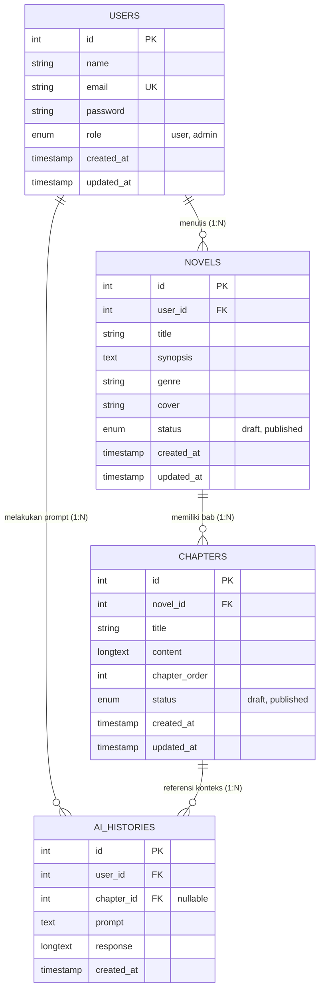

# Dokumentasi Database karyaNovel

Sistem Database Relasional **karyaNovel** dirancang menggunakan engine **MySQL (InnoDB)** dengan charset `utf8mb4_unicode_ci` untuk menjamin integritas data, relasi bertingkat, dan kinerja query penulisan & pembacaan novel berbasis AI.

---

## 1. Entity Relationship Diagram (ERD)



---

## 2. Kamus Data & Struktur Tabel

### 1. Tabel `users`
Menyimpan data akun pengguna, penulis novel, dan administrator sistem.

| Kolom | Tipe Data | Nullable | Default | Keterangan |
| :--- | :--- | :--- | :--- | :--- |
| `id` | `INT` | No | AUTO_INCREMENT | Primary Key |
| `name` | `VARCHAR(100)` | No | - | Nama lengkap / Nama pena penulis |
| `email` | `VARCHAR(150)` | No | - | Email unik untuk login |
| `password` | `VARCHAR(255)` | No | - | Hash password (Bcrypt) |
| `role` | `ENUM('user','admin')` | No | `'user'` | Hak akses pengguna |
| `created_at` | `TIMESTAMP` | No | `CURRENT_TIMESTAMP` | Waktu registrasi akun |
| `updated_at` | `TIMESTAMP` | No | `CURRENT_TIMESTAMP` | Waktu pembaruan profil |

* **Indeks**: `PRIMARY KEY (id)`, `UNIQUE (email)`, `INDEX (role)`.

---

### 2. Tabel `novels`
Menyimpan informasi proyek novel yang dibuat oleh penulis.

| Kolom | Tipe Data | Nullable | Default | Keterangan |
| :--- | :--- | :--- | :--- | :--- |
| `id` | `INT` | No | AUTO_INCREMENT | Primary Key |
| `user_id` | `INT` | No | - | Foreign Key ke `users.id` |
| `title` | `VARCHAR(200)` | No | - | Judul naskah novel |
| `synopsis` | `TEXT` | No | - | Ringkasan alur cerita / sinopsis |
| `genre` | `VARCHAR(100)` | No | - | Kategori / Genre cerita (e.g. Sci-Fi, Romansa) |
| `cover` | `VARCHAR(255)` | Yes | `NULL` | Path file gambar sampul novel |
| `status` | `ENUM('draft','published')` | No | `'draft'` | Status publikasi |
| `created_at` | `TIMESTAMP` | No | `CURRENT_TIMESTAMP` | Tanggal novel dibuat |
| `updated_at` | `TIMESTAMP` | No | `CURRENT_TIMESTAMP` | Tanggal perubahan naskah |

* **Foreign Key**: `fk_novels_user` -> `users(id)` ON DELETE CASCADE.
* **Indeks**: `PRIMARY KEY (id)`, `INDEX (user_id)`, `INDEX (status)`, `INDEX (genre)`.

---

### 3. Tabel `chapters`
Menyimpan bab-bab naskah yang dimiliki oleh novel.

| Kolom | Tipe Data | Nullable | Default | Keterangan |
| :--- | :--- | :--- | :--- | :--- |
| `id` | `INT` | No | AUTO_INCREMENT | Primary Key |
| `novel_id` | `INT` | No | - | Foreign Key ke `novels.id` |
| `title` | `VARCHAR(200)` | No | - | Judul bab (e.g. Bab 1: Pertemuan) |
| `content` | `LONGTEXT` | No | - | Isi lengkap naskah bab |
| `chapter_order`| `INT` | No | `1` | Nomor urutan bab untuk navigasi |
| `status` | `ENUM('draft','published')` | No | `'draft'` | Status visibilitas bab |
| `created_at` | `TIMESTAMP` | No | `CURRENT_TIMESTAMP` | Waktu bab ditulis |
| `updated_at` | `TIMESTAMP` | No | `CURRENT_TIMESTAMP` | Waktu bab disunting |

* **Foreign Key**: `fk_chapters_novel` -> `novels(id)` ON DELETE CASCADE.
* **Indeks**: `PRIMARY KEY (id)`, `INDEX (novel_id, chapter_order)`, `INDEX (status)`.

---

### 4. Tabel `ai_histories`
Menyimpan riwayat interaksi penulisan antara pengguna dengan AI Writing Assistant.

| Kolom | Tipe Data | Nullable | Default | Keterangan |
| :--- | :--- | :--- | :--- | :--- |
| `id` | `INT` | No | AUTO_INCREMENT | Primary Key |
| `user_id` | `INT` | No | - | Foreign Key ke `users.id` |
| `chapter_id` | `INT` | Yes | `NULL` | Foreign Key ke `chapters.id` (opsional) |
| `prompt` | `TEXT` | No | - | Instruksi / prompt yang dimasukkan penulis |
| `response` | `LONGTEXT` | No | - | Teks naskah yang dihasilkan AI |
| `created_at` | `TIMESTAMP` | No | `CURRENT_TIMESTAMP` | Waktu eksekusi prompt |

* **Foreign Key**:
  - `fk_ai_user` -> `users(id)` ON DELETE CASCADE.
  - `fk_ai_chapter` -> `chapters(id)` ON DELETE SET NULL.
* **Indeks**: `PRIMARY KEY (id)`, `INDEX (user_id)`, `INDEX (chapter_id)`.

---

## 3. Cara Menjalankan Migrasi Database

### Melalui CLI (Command Line):
```bash
php database/migrate.php
```

### Melalui MySQL Client / phpMyAdmin:
Impor file `database/schema.sql` langsung ke MySQL server Anda:
```bash
mysql -u root -p < database/schema.sql
```
